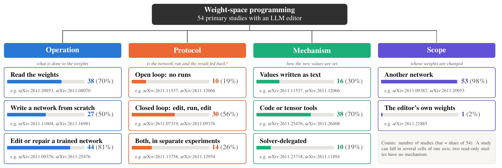

# Weight-Space Programming with Large Language Models: a survey, evidence audit and paper list

Supplementary material and living paper list for

> Bahaeddin Türkoğlu. **Weight-Space Programming with Large Language Models: A Survey.** 2026. (arXiv link will be added here.)

Weight-space programming (WSP) uses a large language model (LLM) to read, write or edit the weights of another neural
network directly, without training it. The term comes from the MIT CSAIL post
[*Sparks of Weight-Space Programming*](https://rikiyat.github.io/blog/weight-space-programming/) (Takehi, Teoh, Zhang
and Khattab, 2 November 2026). This repository holds everything behind the survey: the coded corpus of 70 studies
(cut-off 21 November 2026), every extracted claim with its page and verbatim quote, the **WSP-12** reporting checklist,
the figures, and the code and results of the Qwen3.5-0.8B case study.

**Case study in one line.** On all 500 MATH-500 problems, the GPT-6 Astra weight edit raises Qwen3.5-0.8B from 7.8% to
51.3%; switching thinking off (no weight change) reaches 48.7% with about a third of the tokens, and LoRA on 1,286
solutions written by Qwen3.5-4B reaches 45.0% (86% of the gain). See `case_study/results/FULL_500.md`.

## Contents

| Path | Content |
|---|---|
| `data/studies.csv`, `data/studies.json` | one row per source (80): title, authors, link, group, four-axis codes, evidence codes, failure modes, headline result |
| `data/claims_with_quotes.csv` | 714 extracted claims, each with page and verbatim quote, machine-checked against the source text |
| `data/extracts/`, `data/coding/` | first-pass extraction forms and second-pass codes, one JSON per study |
| `data/audit/` | blind second coding of 13 studies and the agreement (82 of 91 items, Cohen's kappa 0.81) |
| `data/evidence_rows.json` | evidence table of the 54 primary studies: main finding, strongest simple comparison, outcome tag |
| `data/classification.json` | group A (LLM editor, 57), group B (no LLM editor, 13), excluded (10) |
| `data/EXTRACT_SPEC.md`, `data/CODE2_SPEC.md` | the extraction and coding forms |
| `checklist/WSP-12.md` | the WSP-12 reporting checklist, in Markdown and LaTeX, ready to paste |
| `figures/` | all figures as vector PDF and 300-dpi PNG, plus TikZ/pgfplots sources; free to reuse with citation |
| `scripts/` | download, DOI resolution, quote verification and table/figure builders |
| `case_study/` | protocol with dated amendments, code and result tables of the Qwen3.5-0.8B MATH-500 experiments |

The full texts of the reviewed studies are not redistributed; each row links to its arXiv or Zenodo record.

## WSP-12 in one table

| ID | Report |
|---|---|
| C1 | Editor model, version and effort setting |
| C2 | Tools, forward-pass budget and the definition of a pass |
| C3 | Target model, size and number format |
| C4 | Data the editor saw |
| C5 | Several editor sessions and seeds, including failed and unfinished runs |
| C6 | A random or null control of the same size |
| C7 | The cheapest non-LLM edit (mechanical, solver, known rule) |
| C8 | An inference-only fix (sampling, prompt, mode) |
| C9 | A small fine-tuning run on the same data |
| C10 | Held-out and full test sets |
| C11 | Money and wall-clock cost of editor and baselines |
| C12 | Released logs, edits and code; LLM roles in writing and grading |

## Adding a study

New WSP studies appear every day. Open an issue or a pull request with the link; it will be read, coded with the same
forms and added to the list and to the next arXiv version of the survey.

## Paper list (cut-off 21 November 2026)

Operation: R read, W write from scratch, E edit or repair.

### With an LLM editor

| Date | Study | Operation | Domain |
|---|---|---|---|
| 11-03 | [Weight-space programming for auditing clinical decision networks](https://arxiv.org/abs/2611.05341) (Nusrat et al.) | read;edit;write | clinical prediction (radiotherapy head-and-neck pl |
| 11-04 | [IWIBench: Evaluating Gradient-Free Model Driven Intra-weight Injection](https://arxiv.org/abs/2611.08647) (Csefalvay et al.) | read;edit | model editing / text behaviour editing |
| 11-05 | [WeightLoop: Weight-Space Programming with Experimental Feedback](https://arxiv.org/abs/2611.07319) (Li et al.) | write;edit | scientific prediction and experiment selection (ce |
| 11-05 | [Computation, not weight access: large language models as auditors of clinical prediction networks](https://arxiv.org/abs/2611.07847) (Liu et al.) | read;edit | clinical prediction (model auditing) |
| 11-05 | [Can an LLM Actually Reason and Program about Neural Network's Weights or is it just memorization on steroids? Exploring "Weight-Space Programming"](https://arxiv.org/abs/2611.08070) (Ahmed) | read | vision / interpretability (zero-shot weight readin |
| 11-05 | [FedReason: Large Language Models as Weight-Space Meta-Aggregators for Heterogeneous Federated Learning](https://arxiv.org/abs/2611.08383) (Ruzbahani et al.) | read;write | federated learning, security (Byzantine robustness |
| 11-05 | [Weight-Space Programming on Qwen3-ASR-0.6B: Nine Independent Agent Edits, Random-Direction Controls, and a Missing Attention Mask](https://doi.org/10.5281/zenodo.23976684) (Aslantürk) | read;edit | speech recognition (ASR), language identification |
| 11-06 | [Zero-Shot Weight-Space Programming Across a Difficulty-Graded Ladder of Two-Player Games](https://arxiv.org/abs/2611.09271) (Garrido-Merchán) | write | games (two-player board games and chess endgames) |
| 11-06 | [Can LLMs Debug Robots by Editing Their Weights?](https://arxiv.org/abs/2611.09376) (Zhang et al.) | read;edit | robotics (vision-language-action policies, simulat |
| 11-06 | [Exploring Weight-Space Programming: Capabilities, Generalization, and Limitations](https://arxiv.org/abs/2611.09382) (Hu et al.) | read;edit | math reasoning, scientific QA, instruction followi |
| 11-06 | [Can a Language Model Write the Weights? An Empirical Study of LLM-Written Scoring Networks for Column Generation and MILP Branching, with a Bus-Driver Scheduling Application](https://arxiv.org/abs/2611.09559) (Butkeraites) | write;edit | operations research (column generation, MILP branc |
| 11-06 | [Two language models can read and change neural networks, but reliability depends on the task](https://doi.org/10.5281/zenodo.24373915) (scientist) | read;write;edit | interpretability, games, control, math reasoning |
| 11-06 | [A published change to a small language model's weights leaves its default-mode math accuracy unchanged](https://doi.org/10.5281/zenodo.24373917) (scientist) | read;write;edit | math reasoning, reinforcement learning, games |
| 11-07 | [GradReason: LLMs as Meta-Learners that Replace Training Epochs with Training-Data-Free Weight Updates](https://arxiv.org/abs/2611.11005) (Ruzbahani et al.) | read;edit | vision (training acceleration) |
| 11-07 | [Physics2Weight: Direct Neural Network Architecture and Weight Generation from Physical Laws Using Large Language Models](https://arxiv.org/abs/2611.12954) (Sato et al.) | write;edit | physics / PDE solving (scientific machine learning |
| 11-07 | [Weight-Space Programming with Claude Mythos: Weight Edits and Implanted Circuits in a 0.8B Language Model, with Transfer to an Engineering Surrogate (bilingual: English / German)](https://doi.org/10.5281/zenodo.24036186) (Hardani) | read;write;edit | math reasoning; engineering surrogate (power elect |
| 11-07 | [Weight-space programming on a regulatory-genomics CNN: public release 1](https://doi.org/10.5281/zenodo.24040591) (Bruni-Cardoso) | read;edit | genomics (CTCF binding prediction from DNA) |
| 11-08 | [Weight-Space Programming of Variational Quantum Circuits: Large Language Models Write Quantum Circuit Parameters Without an Optimizer](https://arxiv.org/abs/2611.11537) (Kundu et al.) | write | quantum |
| 11-08 | [Weight-Space Programming of Policies and Their Verification via Model Checking](https://arxiv.org/abs/2611.11604) (Gross) | write;edit | safe sequential decision-making / formal verificat |
| 11-08 | [WeightBench v0: two small instruction models at chance on five weight-reading tasks](https://doi.org/10.5281/zenodo.24047726) (Thalluri) | read | weight reading (model property inference from weig |
| 11-09 | [Distilling Instructions into Weights: Closed-Form Edits Fix a Robot Policy's Misreading](https://arxiv.org/abs/2611.11894) (Abbas et al.) | read;edit | robotics (vision-language-action manipulation in s |
| 11-09 | [Weight-Space Programming for Medical Imaging: Do We Still Need Training Data?](https://arxiv.org/abs/2611.12066) (Lindholz et al.) | write | medical imaging (chest X-ray, breast ultrasound, a |
| 11-10 | [Mixed Signals: Weight-Space Programming for EEG and ECG](https://arxiv.org/abs/2611.13758) (Varam et al.) | read;write;edit | EEG/ECG |
| 11-11 | [Owned Edits to a Shared Decision Rule: Learning Private Exceptions as Typed, Gated, Withdrawable Weight Edits](https://arxiv.org/abs/2611.15917) (O'Hare) | edit | federated learning / multi-party rule correction ( |
| 11-12 | [Compiling Known Rules into Compact Neural Agents: Weight-Space Programming on Unseen Games](https://arxiv.org/abs/2611.16981) (Lehmann) | write;edit | games (ARC-AGI-3-style interactive grid games), re |
| 11-12 | [Programming Quantum Circuit Parameters with Large Language Models](https://arxiv.org/abs/2611.17246) (Farias et al.) | write;read | quantum computing (variational quantum eigensolver |
| 11-12 | [Can LLMs Write Backdoors? An Empirical Security Study of Weight-Space Programming](https://arxiv.org/abs/2611.17395) (Wang et al.) | read;edit | security (backdoor injection) |
| 11-12 | [Closed-form neuron rewrites in open-weight LLMs: a constructive Gemma-4-12B edit by a frontier agent, a covert Qwen3.8-27B implant, and what a reference-free weight scan sees](https://doi.org/10.5281/zenodo.24156363) (Dolci) | read;edit | machine translation (English to Italian tense choi |
| 11-13 | [Function-Preserving Audits of Visual Weight Readers](https://arxiv.org/abs/2611.05798) (Cha et al.) | read | vision (neural-field weight readers) |
| 11-13 | [Can Large Language Models Optimize Pretrained Neural Network Weights? A Multi-Phase Empirical Evaluation of Gradient-Free Editing in YOLO26 Object Detection](https://arxiv.org/abs/2611.17789) (Salem) | edit | vision (object detection) |
| 11-13 | [Interpretable weight-space programming builds transparent transformers and brain encoding models](https://arxiv.org/abs/2611.18114) (Mehta et al.) | write | neuroscience (fMRI, ECoG brain encoding); algorith |
| 11-13 | [WeightBench: Evaluating Language Models as Weight-Space Programmers](https://arxiv.org/abs/2611.18553) (Marasini et al.) | read;write;edit | benchmarking LLM agents on weight reading, repair, |
| 11-13 | [Correcting Persistent Failures in Point-Cloud Grasping Policies using Human Demonstrations in Virtual Reality](https://arxiv.org/abs/2611.18919) (Krishnan et al.) | read;edit | robotics (point-cloud grasping) |
| 11-13 | [Agentic Weight-Space Programming as an Alternative to Fine-Tuning in Small Language Models](https://doi.org/10.5281/zenodo.24208534) (Melo) | read;edit | math reasoning (repairing reasoning loops); instru |
| 11-15 | [Weights &amp; Caches: LLMs Can Program Tabular Foundation Models](https://arxiv.org/abs/2611.20174) (Hoo et al.) | read;write;edit | tabular prediction (tabular foundation models) |
| 11-16 | [Weight-Space Programming Changes How an LLM Uses Python for Computational Biology](https://arxiv.org/abs/2611.20566) (Sato) | read;edit | computational biology (tool-using Python problem s |
| 11-16 | [Same Fix, Different Weights: Replicating Weight-Space Programming with Claude](https://arxiv.org/abs/2611.20953) (Kundu) | read;write;edit | reinforcement learning, games, interpretability, m |
| 11-16 | [Can AI Mature a Model's Geometry? Training-Free Weight Baking in LLMs](https://arxiv.org/abs/2611.21310) (Golnari et al.) | read;edit | representation geometry / latent-space organisatio |
| 11-16 | [Replicating and Extending Weight-Space Programming: Frontier LLMs Compile Programs into Weights and Read Input Layers](https://arxiv.org/abs/2611.21449) (Goworek et al.) | read;write | games (MinAtar), vision (MNIST), interpretability  |
| 11-16 | [Language Models Can Rewrite Their Own Weights](https://arxiv.org/abs/2611.21885) (Fan et al.) | read;edit | math reasoning (reasoning-trace termination), faul |
| 11-16 | [Weight-space programming for tractor guidance controller: large language models natively write neural network weights that steer a real tractor](https://arxiv.org/abs/2611.21958) (Oksanen) | read;write;edit | robotics / agricultural vehicle control (tractor p |
| 11-17 | [Weight-Space Programming for Materials Science](https://arxiv.org/abs/2611.22013) (Alvi et al.) | write;read;edit | materials science (alloy and crystal property pred |
| 11-17 | [Weight-Space Programming Doesn't Need Transformers](https://arxiv.org/abs/2611.22055) (Ok et al.) | write;edit | science QA (ARC), text generation/reading comprehe |
| 11-17 | [What Does Weight-Space Programming Add to Diffusion Editing? Program Construction versus Score-Guided Refinement](https://arxiv.org/abs/2611.22228) (Gao et al.) | write;edit | vision (text-to-image diffusion concept editing) |
| 11-18 | [HypoLoop: Revising Weight-Editing Plans from Scientific Feedback](https://arxiv.org/abs/2611.23718) (Li et al.) | edit | scientific prediction (physics, chemistry, materia |
| 11-18 | [In Situ Training of Optical Neural Networks by Coding Agents](https://arxiv.org/abs/2611.23875) (Oguz et al.) | write;edit | optics / physical neural network hardware (vision: |
| 11-18 | [Can Weight-Space Programming Alter Learned Ethical Priorities?](https://arxiv.org/abs/2611.24330) (Ji) | edit | AI ethics / value priorities (synthetic trade-offs |
| 11-19 | [Weight Space Programming for Vision Language Model Repair](https://arxiv.org/abs/2611.23615) (Aluguvelly) | read;edit | vision |
| 11-19 | [WeightCode: Installing New Capabilities into Neural Networks via Weight-Space Programming](https://arxiv.org/abs/2611.25476) (Li et al.) | read;edit | vision robustness (corruptions), compositional lan |
| 11-19 | [Training Vision Models for LLM-Driven Weight-Space Programming](https://arxiv.org/abs/2611.26408) (Ropinski et al.) | read;edit | vision |
| 11-19 | [Weight-Space Programming Writes In-Context Learning and Matches Fine-Tuning in Language Models](https://arxiv.org/abs/2611.26841) (Skianis et al.) | read;edit | language modelling (few-shot word-mapping tasks, i |
| 11-20 | [Zero-Shot Weight-Space Programming for Prediction and Classification of Target Variables in Structured Datasets](https://arxiv.org/abs/2611.19292) (Garrido-Merchán) | write | tabular prediction (classification and regression) |
| 11-20 | [Weight-space programming and mechanistic interpretability for model editing in particle physics](https://arxiv.org/abs/2611.27079) (Bonnet-Guerrini et al.) | read;edit | particle physics (jet tagging foundation model, in |
| 11-20 | [Writing Weights or Training Them? Spatial Reasoning through Weight-Space Programming and Low-Rank Adaptation](https://arxiv.org/abs/2611.27089) (Yang et al.) | read;edit | spatial reasoning (text) |
| 11-20 | [TrojanMaxxing: One-shotting VLM Backdoors with Weight-Space Programming](https://arxiv.org/abs/2611.27425) (Dabholkar et al.) | read;write;edit | security (visual backdoors in vision-language mode |
| 11-20 | [Autonomous Parameter Surgery: How LLMs Implant Selective Backdoors into Language Models](https://arxiv.org/abs/2611.27920) (Liu et al.) | read;edit | security (backdoor implantation in LLM sentiment c |
| 11-21 | [SCALPELLO-GDP: a frontier model edits the weights of Qwen3.5-0.8B directly. One Householder reflection of a 'repetitive re-checking' direction lifts held-out math accuracy from 9.4% to 53.6% (384 paired problems), with no training](https://doi.org/10.5281/zenodo.24416417) (Papa) | read;edit | math reasoning |

### Without an LLM editor (baselines, critiques, tools, theory)

| Date | Study | Operation | Domain |
|---|---|---|---|
| 11-03 | [Weight-Space Programming for Improving Image-Restoration Diffusion Models: Technical Conjectures and a Recursive Improvement Loop](https://arxiv.org/abs/2611.04268) (Zheng et al.) | read;edit | vision (image restoration) |
| 11-03 | [Perceptual Weight Space Programming for Diffusion Super-Resolution](https://arxiv.org/abs/2611.18690) (Zheng et al.) | edit | vision (image super-resolution) |
| 11-03 | [The Mathematics of Weight-Space Programming](https://doi.org/10.5281/zenodo.23933590) (Alonso) | edit | theory of selective weight editing (model editing, |
| 11-04 | [Weight-Space Programming for THOX Edge Models: Evidence Review, Small-Scale Recreation, and a Signed Patch Channel](https://doi.org/10.5281/zenodo.23954378) (Ross et al.) | read;write;edit | math reasoning; edge deployment of LLM patches |
| 11-05 | [Verified by Construction: Machine-Checked Proofs for Hand-Written Transformer Circuits and Their Composition](https://doi.org/10.5281/zenodo.23976715) (Huang) | read;write | formal verification / AI safety (refusal circuits, |
| 11-09 | [W-ISA: Transactional Execution of Weight-Space Intervention Programs](https://arxiv.org/abs/2611.13232) (Aksoy) | edit | interpretability / model-editing infrastructure (r |
| 11-09 | [NCP: Verifier-Guided Optimization of Weight-Space Control Policies](https://arxiv.org/abs/2611.13236) (Aksoy) | edit | inference-time weight interventions; recursive sel |
| 11-10 | [Tree-Ising: Repairing Language Models with Bit-Level Ising Edits](https://arxiv.org/abs/2611.14210) (Salloum et al.) | edit | math reasoning (reasoning-loop repair); quantum op |
| 11-15 | [Weight-Space Audit of MIT-p50c and DNA Weight Editing (SGNE-CC) on Qwen3.5-0.8B at a 32,768-Token Generation Limit (EN / RU)](https://doi.org/10.5281/zenodo.24235217) (Zhuk) | read;edit | math reasoning, symbolic logic, code generation, m |
| 11-16 | [Just sort it! A note on the LP behind rank-one anti-loop edits](https://arxiv.org/abs/2611.21432) (Fischetti) | edit | math reasoning |
| 11-19 | [The Mathematics of Weight-Space Programming: Behavioral Geometry, Constructive Synthesis, and Proof-Carrying Neural Edits](https://doi.org/10.5281/zenodo.24198536) (Macharia) | write;edit | theory |
| 11-19 | [Edits, sparse autoencoders and jet sets for "Weight-space programming and mechanistic interpretability for model editing in particle physics"](https://doi.org/10.5281/zenodo.24377674) (Bonnet-Guerrini et al.) | edit | particle physics (jet tagging and jet mass regress |
| 11-21 | [Knowing Is Not Committing: Replicating MIT's weight-space edit and programming a truth-gated reflex into a 0.8B reasoning model (report)](https://doi.org/10.5281/zenodo.24058693) (Uhlemann) | read;edit | math reasoning |

### Excluded (label only)

| Date | Study | Operation | Domain |
|---|---|---|---|
| 11-04 | [Building foundational models using Weight Space Programming](https://doi.org/10.5281/zenodo.23958069) (Team) | - | LLM model merging, refusal removal and edge deploy |
| 11-07 | [Governed Self-Improvement for a Local-First Security Analyzer: Baseline Measurements and a Preregistered Evaluation Protocol for Tantular Cyber](https://arxiv.org/abs/2611.10425) (Ghifiardi et al.) | - | security |
| 11-09 | [When Weights Collide with Latents: Direct Weight-Space Arithmetic Induces Asymmetric Degeneration in Sparse Autoencoder Monosemanticity](https://doi.org/10.5281/zenodo.24085180) (Rahim) | - | mechanistic interpretability (task-vector arithmet |
| 11-09 | [SOVEREIGN RSI SANCTUARY (V30.1): A Homeostatic, Non-Symmetric Golden Rule, and Cryo-Verified Immune Architecture for Surviving Recursive Self- Improvement, Weight-Space Splicing, and Subliminal Alignment Drift](https://doi.org/10.5281/zenodo.24090396) (Raboin) | - | security (AI safety defense architecture) |
| 11-11 | [Hermetic GeGLU Airlocks and Domain-Adaptive Context Distillation: Exact Zero-Crosstalk Multi-Domain Function Embedding in Quantized GGUF Foundation Models](https://doi.org/10.5281/zenodo.24128861) (moneykoikoi) | - | modular capability embedding in quantized LLMs (RI |
| 11-12 | [ZeGA: Zero-Gradient Gated Adaptation via Weight-Space Synapse Cartridges](https://doi.org/10.5281/zenodo.24168084) (Thulin) | - | language (Swedish), vision-language, image diffusi |
| 11-13 | [Why Finite Intelligence Works in an Infinite World: A Mathematical Theory](https://arxiv.org/abs/2611.18538) (Soltanalian) | - | theory (information theory, rate-distortion, decis |
| 11-14 | [A Backdoor Trigger Is Legible in Fine-Tune Weights](https://arxiv.org/abs/2611.19304) (Khilar) | - | security (backdoor trigger recovery from weights) |
| 11-18 | [Auditing black-box clinical prediction models with a large language model through queries alone: a blinded test with planted flaws](https://arxiv.org/abs/2611.24877) (Liu et al.) | - | clinical prediction (acute ischaemic stroke) |
| 11-20 | [SGNE-CC v2: Editing 205 Weight Columns in DeepSeek-R1-Distill-Qwen-1.5B Improves Greedy Accuracy and Reduces Unfinished Responses](https://doi.org/10.5281/zenodo.24398164) (Zhuk) | - | math reasoning, code generation, science QA and lo |

## Citation

See `CITATION.cff`. The arXiv BibTeX will be added on release.

## Acknowledgment

The numerical calculations reported in the survey were partially performed at TUBITAK ULAKBIM, High Performance and
Grid Computing Center (TRUBA resources).

## Licence

Code: MIT (`LICENSE`). Data, figures and checklist: CC BY 4.0 (`LICENSE-DATA`).
